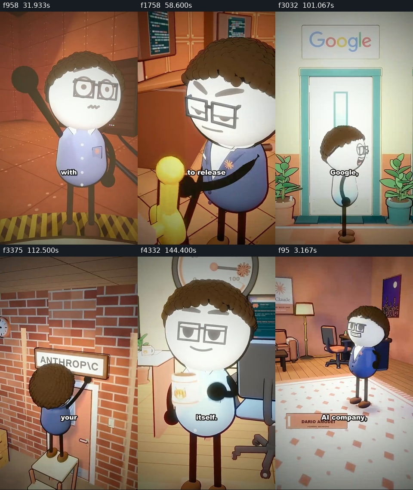
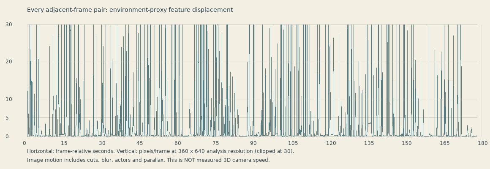
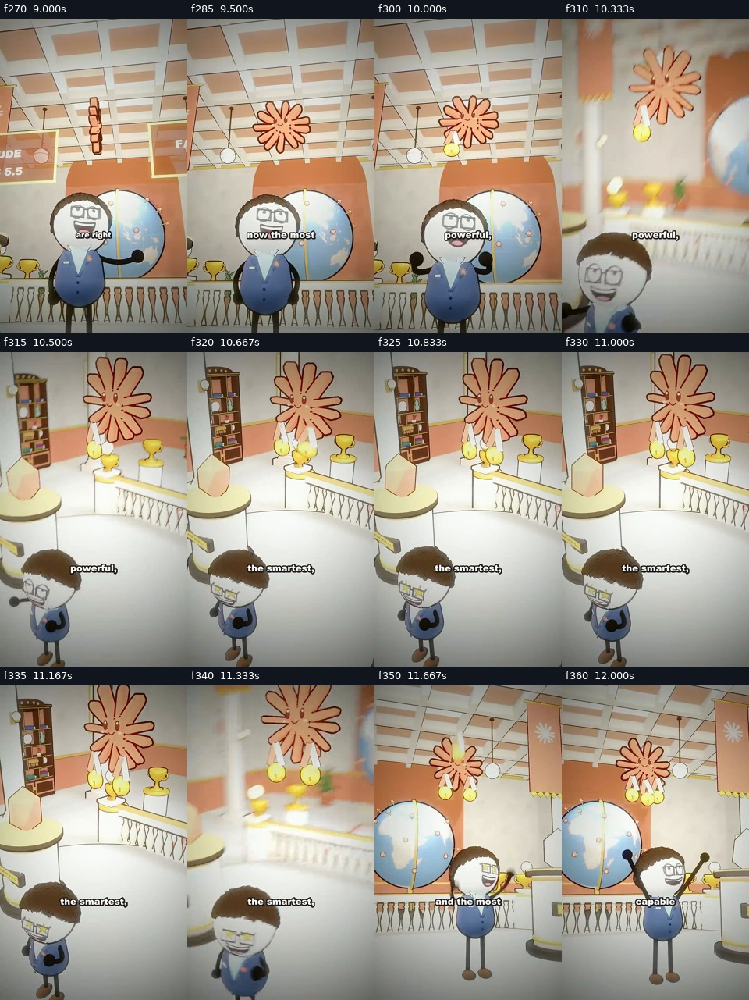
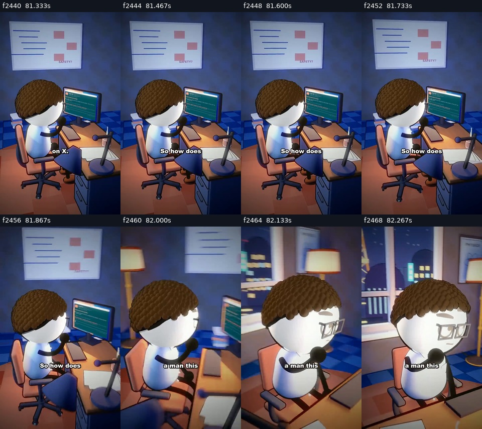
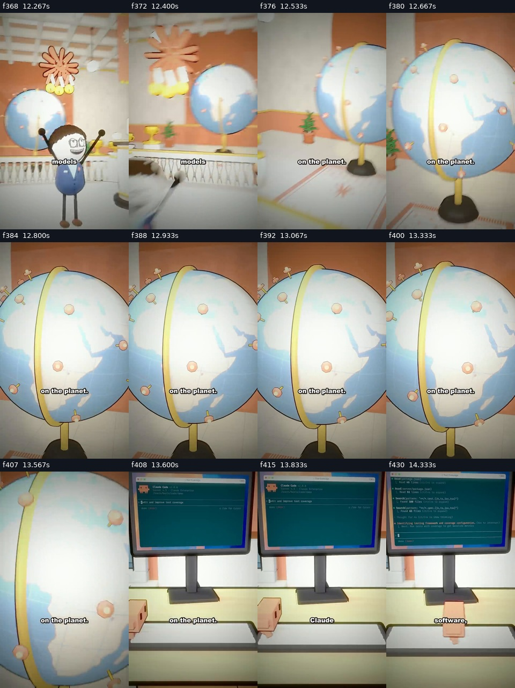
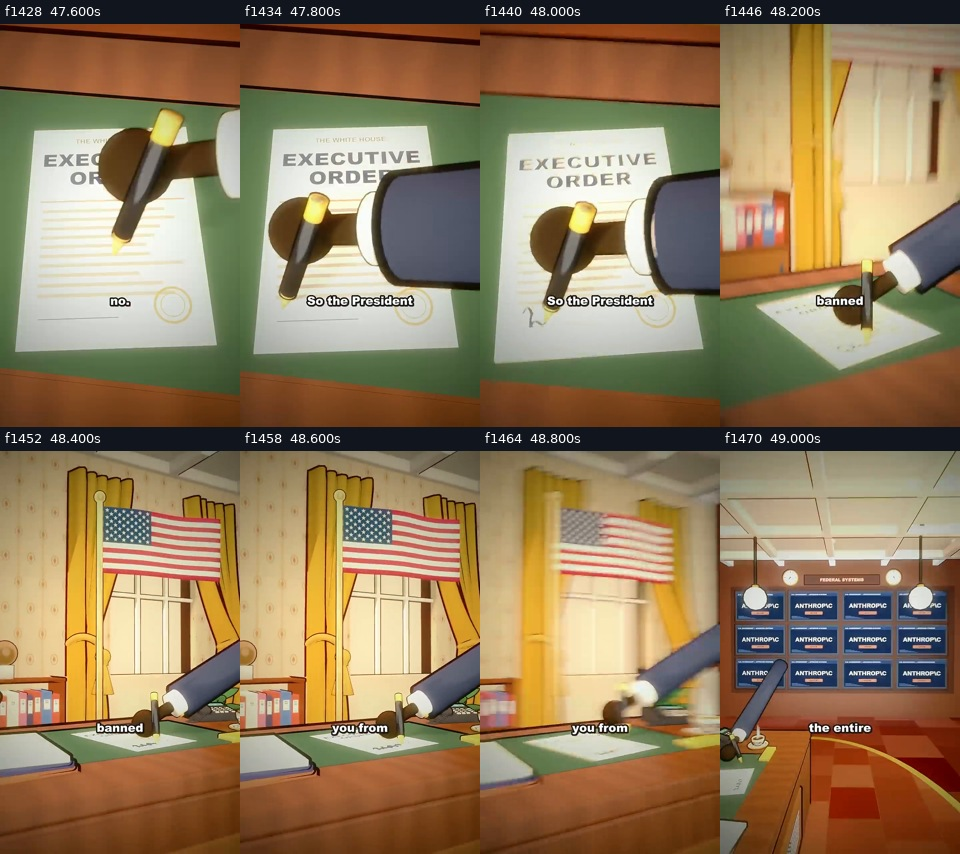

# Dario reference: character construction + camera handling

## Decision — why the five-second engineer was wrong

**The requested target is this Dario reference's stylized, dimensional cartoon cast and its directed moving-camera language, together.** The rejected test was an articulated flat Canvas illustration against largely static scenery with only a tiny overall push. That was the wrong visual system and the wrong camera system. Giving the same test more gestures, bigger eyes or a different palette would not fix it.

The history reference remains a valid analysis of a different video, but it is **not the primary target for the next character/camera test**. The new reference shows rounded head/body volumes, hair seen from front/side/back, thin cylindrical limbs, spherical hands, drawn-looking facial marks and coherent perspective sets. Reproduce that simplified **3D cartoon / illustrated-surface** appearance—not realistic anatomy and not another flat whole-body person.

## 1. Exactly what was reviewed

Source: [user-supplied MP4](https://github.com/ShivAyushNITGoa/Books/blob/ac3e309b651f48f102a5bbb31923ff4da0ce7abf/Dario%20Amodei_%20Why%20Claude%E2%80%99s%20Creator%20Fears%20AI.mp4).

| Item | Evidence |
|---|---|
| Retrieved branch / commit | `arena/f575cde5-books` / `ac3e309b651f48f102a5bbb31923ff4da0ce7abf` |
| Git blob | `8f38039a0d569c3c3475ea61dce7e262d27426da` |
| Bytes | 25,199,881 |
| SHA-256 | `a9d87577f5ab06973ee0738d4c2f85efb99edd5948e6f0130f267d6c984c13b4` |
| Picture | H.264, 720 × 1280 portrait, 30 fps |
| Container A/V duration | Approximately 178.06 seconds |
| Decoded picture frames | **5,339**, zero-based frames **0–5,338** |
| Picture-frame coverage | 177.9667 seconds at 30 fps; first source PTS 0.0333333 s, last 177.966667 s |
| Complete-frame diagnostics | **5,338 adjacent-frame comparisons**, luminance/change measures and optical-flow fits |
| Sequential visual coverage | **All 30 frame-atlas pages inspected**, each containing up to 180 consecutive frames; no deliberate temporal skipping |
| Detail review | Larger temporal sequences plus native 720 × 1280 views at f958, f1758, f3032, f3375 and f4332 |
| Decode check | Full FFmpeg video/audio decode completed, 5,339 frames, no reported failure, zero duplicated/dropped output frames |

**Important limits:** every frame was processed and represented in the reviewed atlases, but each atlas thumbnail is only 64 × 114 pixels. This is not a claim that every frame received native-resolution facial/artifact inspection. Larger views supply the character/gesture evidence. Audio decoded successfully but was not manually listened to. No phonetic lip-sync, sound-design, historical/factual-claim or source-software validation is claimed.

Times in this report are **frame-relative** (`frame / 30`); the source's presentation clock starts about 0.0333 s later. The slightly longer A/V container duration does not indicate missing atlas frames.

### Inspectable deliverables

- [Every-frame atlas browser](frames.html): all 5,339 frames in order, 30 pages.
- [Every-frame measurement table](per-frame-audit.csv): one row per decoded frame.
- [Coverage/diagnostic summary](frame-audit-summary.json), [presentation timing check](presentation-timing-summary.json).
- [Six-second review-block ledger](review-blocks.csv): observations mapped to all 30 atlas pages. These are review blocks, **not a claimed shot count**.
- `audit_frames.py`: reproducible extraction / feature-flow diagnostic; optional dependencies in `requirements.txt`.

## 2. Character design: observed construction

### Shape and proportion

- **Head:** a large near-spherical, pale off-white volume. The rounded silhouette, shaded edge and profile/rear transitions are essential. It is not a realistic skin-colored human head with a modeled nose, ears and lips.
- **Torso:** a small rounded egg/bean form, narrower near the shoulders and fuller low down, with blue/lavender clothing in the presenter's dressed scenes and pale clothing in other scenes. Avoid the rejected engineer's broad rectangular high-visibility jacket silhouette.
- **Limbs:** very thin dark tubular arms and legs. Hands are rounded mitten/ball forms, not anatomically articulated fingers. Brown rounded shoes are small but clearly dimensional.
- **Proportions:** in the large f958 full-body view, the head is roughly two-fifths of visible standing height, the torso about one-third and legs/shoes the remainder. These are approximate image-space design estimates, not recovered model measurements or universal ratios for every pose.
- **Hair:** a recognizable cap of many small rounded brown curls/clusters, with actual-looking thickness over the crown and back. The back-of-head view at f3375 is decisive evidence against simply repainting a front-facing human card.

### Face and identity

- Rectangular dark-gray glasses have a visible bridge and side pieces. Their perspective changes with the head. They are not fixed screen-space icons.
- Simple dark/gray eyes, eyelids, eyebrows and a minimal mouth provide the expressions. Half-lidded/skeptical looks, large alert eyes, smiling/open mouths and closed eyes appear in the sequence.
- Facial marks have a flat/drawn graphic quality **on a dimensional head**. Full photorealistic eyeballs, skin detail, teeth modeling and detailed facial anatomy would move away from this reference.
- The brows, lids and mouth work with head tilt and arm pose. f1758's half-lidded expression plus prop handling reads differently from f958's wide-eyed raised-arm pose.
- Other cast members retain the same basic shape language while changing hair, hats, clothing and expressions. Identity is designed, not produced by unrelated random faces.

### Surface and rendering

- Smooth, mostly matte surfaces with soft tonal gradients; thin dark contour/seam accents and drawn surface details. The reference is **not** the rejected test's thick, clean vector-outline treatment everywhere.
- White faces remain very bright relative to the warm scenery, while curved edges and overlapping hair/glasses supply depth cues.
- Buttons, collar, pocket/emblem, shoe shape and hair clusters provide controlled detail without making the anatomy realistic.
- Warm orange/brown rooms, cream floors, brass/gold fixtures and occasional cool-blue night areas create separation. Soft shadows and occlusion connect cast and props to the set.
- Glow, darker image edges, softened backgrounds and fast-motion blur are visible treatments. Exact render engine, shaders, light units, focal length and post-processing implementation cannot be established from the finished pixels.

**Implementation direction:** use an original stylized depth-aware character rig with actual rounded head/body/hair/limb geometry and face controls attached to the head. A small facial texture/decal on a curved head is not the same as a whole-human billboard. Inspect profile and rear views, not just a flattering frontal frame. Do not claim the creator used a particular software package or rig merely because this is our proposed reproduction method.

## 3. Character performance: what changes through the frames

- **Presentation:** f270–300 changes hand placement and facial expression while the set remains readable. f350–368 lifts both hands for an emphatic pose.
- **Interaction:** f1758 holds/works around a physical-looking yellow control/prop; f4332 holds a mug in front of the torso, with the arm and hand visibly related to the object.
- **Seated work:** around f2440–2535 the character is seated at a desk with the chair, monitor and tabletop occupying different depths. Camera movement reveals the head/torso rather than spinning a flat figure to face the lens.
- **Locomotion and facing:** f3025–3075 presents lateral travel, profile and a rear-facing approach to a door. The face is no longer kept visible at all costs.
- **Rear task pose:** f3375 shows the back of the head and clothing while the hands reach toward a sign, with shoes resting on a chair. The action has a target and a support.
- **Reactions:** blinks, eyelid changes, head tilt and changes in mouth shape accompany larger gestures. Not every limb moves continuously; clear poses are allowed to settle.

This is an economical cartoon rig, not an argument for anatomical complexity. The important test is **consistent volume + purposeful acting + prop contact + correct facing**, not maximum joint count.

## 4. Camera handling: the underlying grammar

### A. Establish → enter → reveal → read

The opening begins with the exterior skyline, rapidly approaches the branded tower and moves into an interior presentation. Elsewhere, wide rooms establish a subject and the view then moves toward the host or a meaningful prop. The camera is not just a constant-speed decorative drift.

### B. Rapid transfer → settle → action

Many camera changes are brief bursts followed by comparatively quiet reading/acting periods. The set does not keep spinning while a prop label or expression needs to be understood. Speed contrast is a central part of the handling.

A screen-space diagnostic supports that observation. At 360 × 640 analysis resolution, median environment-proxy feature displacement is approximately:

| Relative interval | Median tracked displacement per frame | Visual interpretation |
|---|---:|---|
| 9.00–10.00 s | 0.11 px | Presenter view largely settled while posing changes |
| 10.267–10.533 s | 9.72 px | Fast camera/reframing transfer |
| 10.60–11.10 s | 0.13 px | Elevated view settles again |
| 11.30–11.70 s | 7.25 px | Another fast change toward the next composition |
| 81.33–81.80 s | 0.10 px | Rear/side desk composition reads |
| 81.80–82.30 s | 5.49 px | Camera sweeps to reveal the face and room depth |

These values are **not camera velocity in meters/second**, and not pure background ground truth. The proxy mask may include actors/graphics, and blur, parallax and cuts affect the estimates. They describe tracked image motion and must be interpreted with the frames, not substituted for visual evidence.

### C. Independent position and aim

The subject's screen position, angle and scale change intentionally. Camera translation, vertical position and view direction are not locked to one fixed actor offset. Sometimes the face is the focus; sometimes the hand, control, monitor or wall display becomes the focus and the actor leaves the frame.

### D. Arcs and height changes reveal volume

At roughly 10.3–10.7 s, the view shifts rapidly from a near-frontal presenter composition to a higher oblique view. Ceiling/floor balance, pedestal overlap and the visible side/top of props change. Around 11.3–11.7 s, it returns toward another frontal composition. This is not equivalent to a 2D zoom on the same artwork.

At about 81.8–82.3 s, the chair, foreground microphone/desk, head and night-window background move differently. This **parallax and changing overlap** is the spatial signature missing from the rejected prototype.

### E. The camera follows the idea into a prop

The globe transition at f368–392 (about 12.27–13.07 s) lets the presenter move out of the composition while the globe takes over. Its stand, meridian ring and sphere are revealed at changing size and angle. At **f408 / 13.600 s**, the view changes distinctly to the monitor. Do not pretend that this is one uninterrupted physically recovered camera path.

At about 47.6–49.0 s, the document/pen detail opens into a broader desk/room composition. The prop detail explains an action; the following view supplies context. This is stronger than holding the host and all props at the same size for the entire beat.

### F. Camera motion and editing are different tools

There are obvious abrupt scene changes, whip-like blurred transfers and visible dissolves. The office-to-outdoor transition around f2545–2555 is an example of a visible blend. The video is **not proven to be a single continuous take**, and its motion cannot all be attributed to one physically continuous 3D camera. The next test can reproduce a representative spatial move without copying every cut or claiming the whole film has no edits.

### G. Lens, composition and image finish

- Perspective floor/ceiling lines and near/far size differences make rooms feel deep. Close foreground objects create more convincing movement than background-only translation.
- The camera alternates wide context, full-figure presentation, medium/close facial views, overhead/oblique task views and object details.
- The host is not fixed to the exact center/scale throughout. Space is reserved for the prop or action being explained.
- Caption text is relatively small, bold white with a dark edge, near the lower-middle action area. The rejected test's large title plus bottom descriptive labels was a different graphic language.
- Apparent wide perspective is visible, but exact focal lengths/FOVs are unknown. Do not attach invented lens numbers to the reference.

## 5. Full-timeline review map

Each row covers one **six-second atlas page** (last page shorter); all underlying consecutive frames are available in the [atlas browser](frames.html). Detailed per-block notes are in [the CSV](review-blocks.csv).

| Time | Principal staging / camera behavior |
|---|---|
| 0–6 s | Night city approach, tower/window entry, office host angle changes, then lab establishment |
| 6–12 s | Lab context, presenter reveal, quick elevated oblique move and return to frontal emphasis |
| 12–18 s | Globe push/detail, monitor change, desk reveal, rapid room/clock/night-window transfer |
| 18–24 s | Bed vignette, auditorium, steep overhead drop/prop view, transfer into fundraising room |
| 24–30 s | Fundraising context, lateral reveal of another character/rocket, seated presenter, safety-object insert |
| 30–36 s | Glowing guarded object, host close/full view, safety display and wide auditorium/crowd reveal |
| 36–42 s | Exterior aircraft, desk close-up, ceremonial room host, rapid oblique transition to overhead building view |
| 42–48 s | Building facade, meeting room, move around long table, signing-document insert |
| 48–54 s | Document/hand pullback, federal display, storage-room cast exchange, rack/shelf detail |
| 54–60 s | Shelf return to host, glowing central exhibit, host reveal, high oblique prop/control interaction |
| 60–66 s | Shift back to exhibit, globe/data visual with changing count and rotating geography |
| 66–72 s | Overhead round table, successive seated-character views, wide reset, server/corridor views |
| 72–78 s | Corridor exit, outdoor display, repeated capsule row, lateral passes, host revealed beside prop |
| 78–84 s | Two-character scene, handheld-screen insert, reset to wide, cut to desk and rear-to-front sweep |
| 84–90 s | Desk expression, visible transition to outdoors, institution facade, host, crest detail |
| 90–96 s | Laboratory bench, table vignette, calendar close-up/time changes, office shelf context, outdoor transfer |
| 96–102 s | Small host in landscape, clock detail/transfer, AI sign, corridor reveal and profile/back-facing approach |
| 102–108 s | Enter new workplace, server displays, presenter/interlocutor, calendar transition and exterior group |
| 108–114 s | Exterior group, driving/control cutaways, blueprint presenter, rear sign installation and pullback |
| 114–120 s | Door/host establishment, graph hall, small bar and host, widening and rising graph bars |
| 120–126 s | Graph-height read, host reveal, launch-event wide shot and push/reframe toward stage |
| 126–132 s | Stage action/prop, busy office reveal, balcony/rail foreground and close task view |
| 132–138 s | Balcony retreat, long conveyor perspective, package detail, pullback to multiplying objects/data |
| 138–144 s | Server/count insert, host near conveyor, office wide, dial close-up, monitor-to-host sweep |
| 144–150 s | Mug/host close view, glass-partition wide view, clipboard character, return to desk/report insert |
| 150–156 s | Report detail/page changes, host at desk, robot lab wide, move to robot close-up, gauge setup |
| 156–162 s | Gauge/host presentation, shift to outdoor circular mechanism, return to robot hall |
| 162–168 s | Robot hall lateral/forward changes, robot close view, circular-mechanism insert, driving setup |
| 168–174 s | Driver, tunnel/safety transition, foot/pedal insert, return to driver, visible blend to lab ending |
| 174–end | Host beside reset control, small gestures/head changes, settled ending composition |

## 6. Non-negotiable corrections to the next five-second test

| Rejected test | Dario-led replacement requirement |
|---|---|
| Flat articulated warm-skinned engineer | Rounded pale-headed stylized 3D cartoon character, small bean torso, thin dark limbs, rounded hands/shoes |
| Broad jacket and thick vector contours | Reference-compatible compact silhouette, restrained surface details, softer tonal rendering and fine contour accents |
| Generic large oval eyes in a flat face | Minimal drawn facial language on a rotating dimensional head; meaningful eyelids/brows/mouth changes |
| Little or no side/back evidence | Camera must reveal front → three-quarter/profile depth; hair, head, torso and props stay coherent |
| Almost-static harbor composition and 1.2% overall zoom | Actual perspective camera translation + aim change, visible foreground/background parallax, change of height and a readable settle |
| Stand-alone gesture in empty space | A purposeful interaction with a staged object, with a controlled hand/prop relationship |
| Dominant top title / changing explanatory labels | Clean picture-led framing; captions only where useful, not a new title-card layout |

### Proposed five-second directing specification (a new plan, not measured source timings)

- **0.0–0.8 s:** a spatially readable establishing move into a warm, dimensional workspace; character and target prop both legible.
- **0.8–1.7 s:** ease into a medium three-quarter presenter view; facial/gaze reaction and preparatory hand motion.
- **1.7–2.7 s:** a short motivated arc with a modest height change; foreground desk/rail and rear wall show different parallax, while the character does not automatically rotate to face the lens.
- **2.7–3.6 s:** camera and aim favor the hand/prop action rather than keeping the entire figure centered.
- **3.6–5.0 s:** settle into an intentional reaction/completion frame. Avoid spending all five seconds in a fast orbit.

Speed, framing and shape fidelity must be tested together. Do not declare a match from a lone frontal still. A next test must actually include a camera move that reveals the rig's depth; it should use original subject-appropriate character/prop design, not copy Dario's likeness or the source's logos by default.

## 7. Scope and standing instructions

- The user rejected `projects/character-style-test/`; mark it **rejected**, not approved, and do not build the next sample by tweaking that same flat illustration.
- This Dario clip is now the primary style/camera reference. The earlier history-derived illustration-only direction is superseded for this request.
- Preserve frozen approved originals and accepted script/voice assets. Neither old character policy nor old no-orbit thresholds should silently override the latest reference-led test direction. That does not require repeated circling or copying every fast edit.
- The existing ship MP4 is not changed by this analysis. Its earlier slow-camera requirements remain part of that delivered revision unless the user requests a new cut; a new test should follow the latest explicit request for Dario-style camera handling.
- This report supplies a concrete target and frame-complete evidence. It does **not** claim a newly matched video, exact source-rig recovery, manually reviewed audio or full-resolution inspection of all 5,339 frames.
