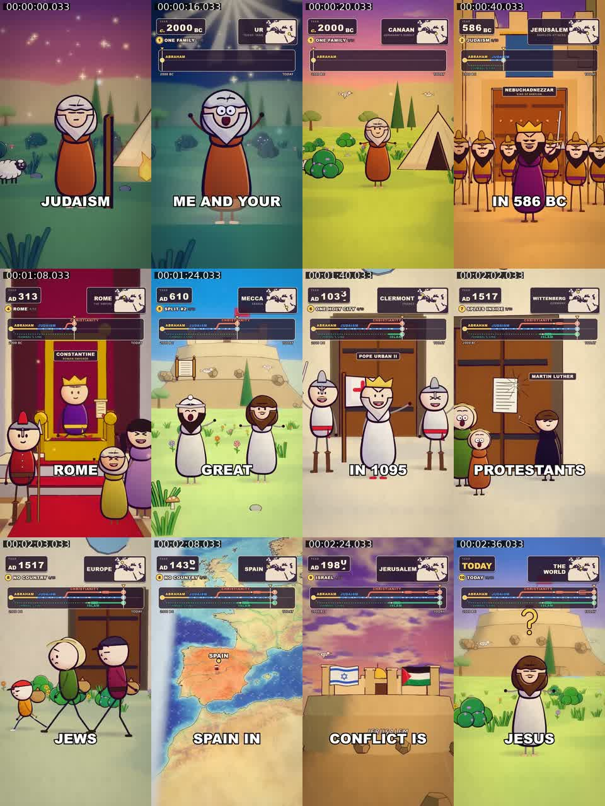
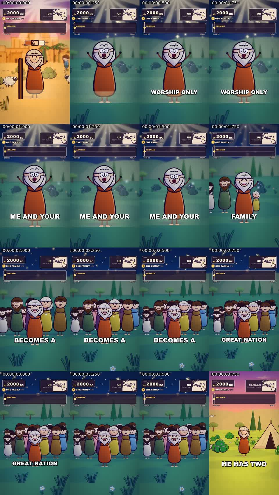
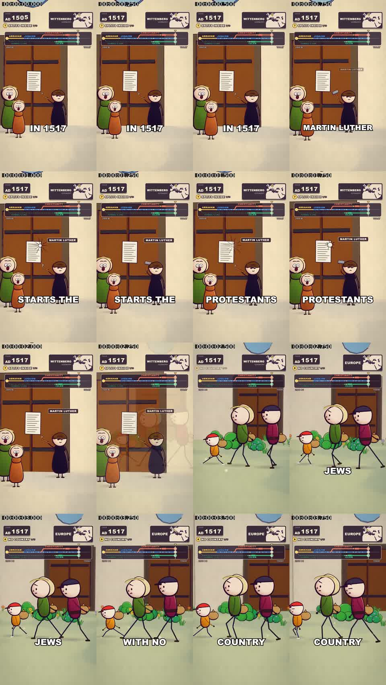

# Character reference analysis: *Judaism, Christianity, Islam in 4,000 Years*

> **Latest user correction:** the five-second history-derived engineer test was rejected. The [Dario character + camera analysis](../dario-character-camera/ANALYSIS.md) is now the primary direction for the next test. The observations below describe this history reference, not approval of that rejected prototype.

## Executive finding

**The useful target is an expressive illustrated character system, not a static human picture placed on a camera-facing card.** The reference's visible treatment is predominantly 2D / layered 2.5D cartoon illustration, with soft shading and staged depth. It is not evidence that realistic full-3D human meshes are required. Equally, the finished pixels cannot establish whether the creator used vector rigs, drawn sprites, 3D assistance, generated imagery or some combination.

The previous guidance that translated the request into a necessary “volumetric silhouette” test was premature. Match the observed visual result and acting, not an unverified production technique. A flattened, non-articulated billboard still does not meet the request merely because it now has rounder artwork.

## Source and review method

- User-supplied repository link: https://github.com/ShivAyushNITGoa/Books/blob/main/Judaism%2C%20Christianity%2C%20Islam%20in%204%2C000%20Years.mp4
- Retrieved from `main` commit `dfff353abfceb174b173767b8251658c86685b85` via Git, without switching the working branch.
- Source Git blob: `b99454a7dda378b03a7d6014d5351065698d70e0`.
- File: **22,666,426 bytes**; SHA-256 `18f806581f8461ddad6c2911ecdbc4a59f20297681757e6b0f69631dd5283de3`.
- FFmpeg reports approximately **160.85 seconds**, **720 × 1280**, **30 fps**, H.264 picture and 44.1 kHz stereo AAC audio. Complete decode produced 4,823 video frames without a reported decode failure.
- Visual inspection: 41 overview frames at four-second intervals across the programme; full-resolution detail frames at 1, 16, 84 and 122 seconds; four temporal contact sheets sampled at 0.25-second intervals around the opening, raised-arm/family reveal, two-person explanation and walking transition.
- Temporal sheets are **discrete frame inspection**, not real-time playback or an every-frame perceptual review. Audio was decoded but not manually listened to. Claims about exact lip sync, sound design, spoken delivery and phonetic articulation are therefore excluded.
- A scene-change threshold of 0.22 produced 35 candidates. That is a diagnostic, **not** a verified count of shots: flashes, graphic changes and dissolves can trigger or evade it.
- The separate Dario Amodei reference remains unreviewed beyond its page metadata. No two-video comparison is claimed.

The full source video and scratch extractions remain in ignored `Animation/output/character-reference/`; they are not duplicated into Git. The small evidence sheets below are excerpts for this requested analysis, not reusable character assets or a license grant.

## Timestamped visual evidence

| Approximate source time | Directly visible evidence | Production lesson |
|---|---|---|
| 0–3.75 s | Large orange-robed central character; face changes between relaxed smile and wide-eyed open mouth; colored symbols grow/move above; stars and rays animate | The hook is a readable character plus one evolving idea, not a distant person beside a slide |
| 8 s | A small pair of characters is staged together against a green field | Character scale and number change with the explanation rather than staying fixed |
| 16 s | Both arms raised; large eyes, open mouth, strong eyebrows; beard frames the face; cool backdrop and light rays | Face and pose communicate immediately; background lighting supports the beat |
| 16.75–18.5 s | Additional people appear behind the lead; the composition pulls wider/reframes to accommodate a group | Turn an abstract family/nation concept into a visible ensemble, with foreground/background hierarchy |
| 20 s | Warm camp environment, tent, plants and smaller central person | Locations have their own palette, props and composition; character styling remains coherent |
| 40 s | Crowned purple-clothed figure in front of a repeated guard formation | Costume and silhouette identify roles quickly; foreground lead and supporting group have distinct hierarchy |
| 68 s | Throne composition with crowned central figure and foreground attendants | Depth comes from overlap, scale and perspective scenery, not necessarily anatomical realism |
| 84 s | Two white-robed figures with distinct beard/hair silhouettes; one has open mouth/closed curved eyes, the other a restrained smile | Do not give everyone the same face, expression or action at once |
| 100 s | Central crowned religious figure flanked by guards, with emphatic expressions | Repeated body construction can support differentiated roles and reactions |
| 120–122 s | Character raises a hammer toward a posted sheet; onlookers react; an impact mark appears | Action has a target and consequence; a prop must be connected to the hand and task |
| 122.5–123.75 s | Three figures in side view, carrying bags, with changing leg configurations and relative positions | Walking needs articulated pose changes and direction-specific artwork, not just translation of an unchanged front view |
| 128–144 s | Illustrated geography and highlighted routes/regions replace the cast | The reference alternates maps and character scenes; it is not an uninterrupted camera journey |
| 156 s | Individual bearded figure and a large question mark in a simplified setting | Reduce competing detail when the concept is a single question or contrast |

## 1. Character design language

### Silhouette and proportion

- Large circular/oval heads sit over compact tapered robe/bean-shaped torsos. In the clear 16-second full-body frame, the head including beard/hair is roughly two-fifths of the standing figure's height; this is an illustrative estimate, not a universal ratio for the whole cast.
- Legs and arms are deliberately thin. Hands can be small dark circles; feet are short rounded shapes. The reference does **not** depend on detailed fingers, realistic muscles or anatomical clothing simulation.
- Clothing forms one clean, readable mass. Robe colors, crowns, hats, beards, hair and carried props differentiate identities at small sizes.
- Thick dark-purple/near-black contours keep bodies and faces readable against textured backgrounds. Small interior facial marks use the same visual family without becoming as heavy as the outer silhouette.

### Faces

- Pale warm faces, dark eyebrows and simple eyes carry much of the acting. Visible alternatives include dot eyes, large white circular eyes with dark pupils, and closed curved-eye smiles.
- Mouths change from a small smile to a large dark open oval or broad grin. Eyebrows and eye shapes reinforce the expression instead of leaving the face neutral while only the mouth changes.
- Hair, beard and headgear are strong designed shapes, not photographic textures pasted onto a generic body.
- The sampled frames support **expression changes**; they do not establish phoneme-accurate lip sync.

### Surface treatment

- Fills are not uniformly flat: subtle warm/cool gradients, side shading, beard/hair facets and soft highlights suggest roundness.
- Outlines remain the main structural signal. There is no prominent skin-pore, metallic-skin or photorealistic specular treatment.
- A restrained local palette makes each figure coherent; richer scenery and effects provide variation without overwhelming the face.

**Translation:** build original task-appropriate cartoon workers/engineers with this clarity and expression range. Do not copy the reference's historical/religious costumes onto an unrelated ship story.

## 2. Acting and motion

### Raised-arm and group reveal: about 15–18.75 s

The hero moves from an individual explanation to an expanded group composition. Raised arms, changed eyes/mouth, arriving supporting people and a wider framing are coordinated around that visual idea. Some poses hold across several samples; the shot is not constant full-body motion. This matters: **a deliberate held pose is different from a static card whose limbs and face never act.**

### Tool use and walking: about 120–123.75 s

The hammer changes orientation near the posted paper and a drawn impact burst makes contact legible. The following walkers present side-facing heads/bodies, bags behind them and alternating leg configurations. This is stronger than sliding a frontal sprite through the scenery.

The samples are insufficient to certify perfect foot locking, a complete gait period or exact easing curves. Those become quality requirements for our implementation, not unearned claims about this reference.

### Proposed animation vocabulary

These are requirements derived from the reference, **not measurements of its original rig**:

- Independent head, brows, eyes, mouth, torso, arms, legs and held-prop controls.
- Neutral, pleased, surprised, concerned and explanatory expressions; blinking and intentional gaze changes.
- Reach/point/raise/retract gestures with preparation, readable key pose and settle.
- Front, three-quarter and side-facing presentation, selected to suit the shot rather than always facing the camera.
- Walks with alternating planted/swing legs, modest body response and a clear stop/settle.
- A prop grip and an actual interaction target; release/contact/impact states where the action needs them.
- Deterministic time sampling, so an exported frame and an arbitrary seek to that time produce the same pose.

## 3. Staging, environment and lighting

The cast belongs to a consistent illustrated world: faceted rocks, simplified trees, flowers, tents, buildings, soft terrain gradients and perspective interiors. There are multiple depths, but their outlines and color treatment agree with the characters.

The cool teal scene at 16 seconds contrasts with warm yellow/green camps and golden interiors. Rays, glows, stars and vignette-like edge darkening focus attention. These effects suggest atmosphere; they do not prove a physically based lighting rig. Ground integration is relatively simple, so adding stronger foot contact to our own work would be a quality improvement, not a copied observation.

For the ship project, the old people can remain technically present yet feel disconnected if they are tiny, generic and perform no narrated task. Changing only the material on their existing plane would preserve that problem. Reblock any important human action at a scale where face, hand and task are legible, while keeping people clear of the bulb/model and captions.

## 4. Direction and visual information hierarchy

- The opening devotes a large part of the portrait frame to one expressive lead, then introduces symbols above the head. Visual changes are concentrated around a small number of focal areas.
- Later scenes often retain a year/location display and branching timeline in the upper portion. This persistent information layer connects changing places and centuries.
- Large white uppercase captions with heavy black outlines sit near the lower action region. They remain readable, but sometimes overlap clothing. Copy the contrast and concise phrasing—not every overlap or the exact layout.
- The edit alternates character vignettes, perspective sets and textured geography. Shot changes and reframing provide much of the dynamism; it would be incorrect to credit everything to 3D camera motion.
- The family reveal visibly widens/reframes as more people enter. Finished images alone do not tell whether this is a lens change, a camera move or scale animation.

**Do not copy unrelated constraints.** The ship brief still asks for slow, non-circling camera work and preserved narration. The reference's frequent cuts, dense timeline HUD and historical-map treatment are observations, not permission to replace the ship's established direction wholesale.

## 5. Difference from our current people

Source inspection confirms `bulbous-bow/world.js::buildCast` uses 384 × 640 canvas textures on 1.9 × 2.8 m upright planes, with unlit `MeshBasicMaterial` and automatic camera-facing yaw. The imported `black-box-rebuilt/world.js::drawPerson` already redraws a sinusoidal arm wave; the people are **not literally unanimated**. However, the drawn eyes/mouth/legs stay fixed, cast positions do not follow task paths, and the movement is not a beat-specific reach, reaction or walk. Separate ground-shadow planes are already present. The needed improvement is directed, differentiated performance and view consistency—not simply adding a first movement or shadow.

| Current ship implementation | Reference-derived target |
|---|---|
| Whole character drawn to a canvas-backed, upright camera-facing plane | Independently controlled face/body/limb/prop performance; no perceptible stiff card turning with the camera |
| People mostly small environmental silhouettes | Deliberately staged, readable foreground or midground roles when human action matters |
| Same general billboard behavior across angles | Direction-specific front/three-quarter/profile presentation |
| Presence alone signals activity | Gesture, reaction, locomotion and targeted prop use explain the beat |
| Character outline/shading can feel separate from the dimensional set | Consistent palette, contour treatment, illumination cues, occlusion and grounded feet |

A **layered articulated illustration** could be faithful in an illustration-led film. A **stylized depth-aware rig with illustrated outlines/facial controls** may integrate better with the existing moving 3D ship world. Neither technique is automatically the right choice; test the visible result. Crossed planes or an extrusion of an unchanged sprite are not a substitute for acting and view consistency.

## 6. Concrete replacement preview specification

Before another long film export, make a short original engineer/worker test, not a copy of the source character:

1. Establish the complete figure in the intended environment and caption layout.
2. Show a blink/gaze change and a clear expression transition.
3. Have the character reach/point toward a real prop, then settle.
4. Show a short side/three-quarter walk with a grounded stop.
5. Check a changed camera bearing: no card edge, flat-paper reveal, broken silhouette or automatic frontal spin.
6. Check hand/prop and feet/floor contact; inspect occlusion by the actual scene.
7. Retain the ship's accepted script/voice, integral bow, immersion, stable floor and slow one-sided camera unless separately changed.

Acceptance is visual **and** technical: expressive silhouette and face at final portrait size; task-specific acting; stable identities and limb lengths; no foot slide or object penetration; deterministic seeks; no caption collisions; no realistic-human redesign imposed without need.

## Status and limitations

This report completes a detailed **sampled visual/temporal analysis of the supplied history reference**, not of both original links. The Dario video still needs an accessible file. This does not certify the video's historical/theological claims, identify its production software, establish original rig structure or license, or claim manual audio review / every-frame viewing.

Guidelines are updated. After this analysis the user requested a five-second character test; [the standalone illustrated engineer prototype](../../projects/character-style-test/README.md) now demonstrates a short entrance, expression change and targeted gesture. The user subsequently rejected that prototype. It is not a full-3D rig, complete view turnaround, newly restyled ship MP4 or proof of reference parity. Whether to revise the existing ship film, apply this to future films, or both remains unconfirmed. Do not silently rerender the full film on an unresolved scope assumption.
